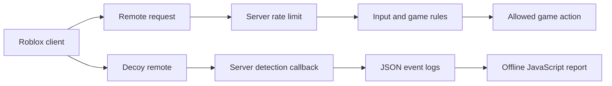

# Roblox Anti-Cheat Starter

Server-side checks for Roblox games, with a JavaScript tool for reviewing detection logs.

[Studio setup & API](docs/REFERENCE.md) · [MIT license](LICENSE)

## What's included

| Part | Language | Purpose |
| --- | --- | --- |
| RateLimiter | Luau | Limit requests per player and action |
| Validation | Luau | Check string lengths and finite numeric ranges |
| Guard | Luau | Detect calls to a decoy remote; log, kick, or temporarily ban |
| Example server | Luau | Show how the modules fit into a Roblox game |
| Log report | JavaScript | Summarize exported detection events from the command line |

**This does not block every cheat.** It cannot reliably identify injected software and has no built-in speed, flight, teleport, reward, or aimbot detection. Those rules depend on the game. Rate limiting blocks excess requests; it does not prove a player is cheating.

## How it fits together



The server owns the decision. A legitimate game script must never call the decoy remote. Start with logging, check your integration, then choose whether kicking or temporary bans make sense for your game.

## Start in Studio

1. Put the three modules from `src` in an `AntiCheat` folder under `ServerScriptService`.
2. Create `ExampleAction` and `DecoyRemote` RemoteEvents in `ReplicatedStorage`.
3. Copy `examples/Example.server.luau` into a server Script. It starts in logging mode and does not grant items or change game state.
4. Add your game's server-owned permission, distance, item, and player-state checks to the action handler.

The [reference](docs/REFERENCE.md) covers arguments, return values, ban configuration, cleanup, and integration checks.

## Reviewing logs

The example prints a JSON object for each honeypot detection. Save the JSON objects to a `.jsonl` file, one per line, without Studio's timestamp or script-location prefixes. This is a manual export format; the CLI does not connect to Roblox or collect logs automatically.

Try the fictional sample with Node.js 22 or later:

```sh
node tools/report.mjs tools/sample-events.jsonl
```

```json
{
  "events": 2,
  "ignored": 1,
  "reasons": {
    "honeypot_remote": 2
  }
}
```

Input is a path to a JSON Lines file. Detection objects have `kind: "anticheat_detection"` and a nonempty `reason` of at most 80 characters. The example also records `userId` and `timestamp`; the report only counts reasons and never prints player identifiers. Other JSON objects are counted as ignored. Invalid JSON or malformed detection records produce a line-numbered error and a nonzero exit code.

Counts are observations, not ban recommendations. The report reads locally and writes JSON to standard output; it makes no network requests or enforcement decisions.

## Development status

The Roblox integration and Ban API have not been tested in Studio. Included unit tests cover the pure limiter and validation helpers, plus the JavaScript report. They do not verify live game behavior or the enforcement module.

```sh
lune run tests/run
node --test tools/report.test.mjs
```

See Roblox's [server-side detection guidance](https://create.roblox.com/docs/scripting/security/server-side-detection) for the reasoning behind server-owned checks and reversible enforcement.
